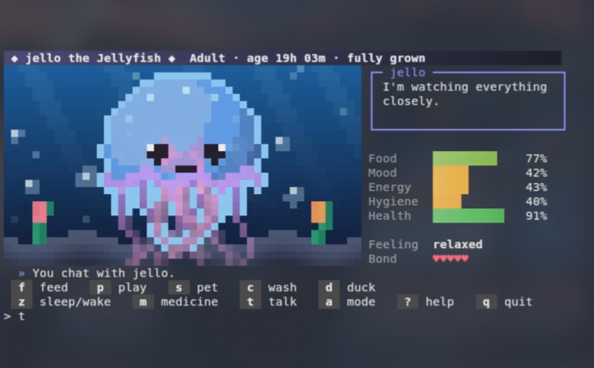

# Terminal Pet

A Tamagotchi for your terminal, written in Rust with **no dependencies** (standard library only).
<p align="center">
  
</p>
Pick one of five creatures, watch it hatch, feed it, play with it, keep it clean - and when you're stuck on a bug, explain it to your pet (rubber-duck debugging, but with a penguin).

```
          .---.
         / ^ ^ \
         \ <u> /
        .-'---'-.
       \ |     | /
        \|     |/
        \ \___/ /
        /_\   /_\
```

*(a happy adult penguin in ASCII mode - the default ANSI mode is full-colour pixel art)*

## Features

- **Five pets** - Jellyfish, Frog, Fox, Penguin and the invented light creature **Glimmi**. Each has its own personality, food, sound, speech, scene, facts, and speed at which it gets hungry, bored, tired and dirty.
- **Two display modes** - animated **ANSI pixel art** (a 50x28-pixel canvas drawn with half-block characters, truecolor with a 256-colour fallback) and plain **7-bit ASCII** for any terminal. Switch at any time with `a`.
- **Emotions** - ten moods (asleep, sick, hungry, tired, grumpy, lonely, sad, relaxed, happy, ecstatic) and seven short reactions (eating, playing, being petted, washing, medicine, listening, eureka), all drawn for every pet.
- **Life cycle** - egg -> baby -> adult, in real time, with a bond meter (five hearts) that grows with the care you give.
- **Facts** - ask for biology, behaviour and fun facts about the species you're raising (`i`); feeding sometimes comes with one, too.
- **Rubber-duck mode** - explain your code to your pet. It listens, asks a fitting question and celebrates when you have a eureka moment.
- **Centred UI** - the screen is centred in your terminal and re-centres itself when you resize the window.
- **Persistent** - saved automatically; the pet keeps living (more slowly) while the program is closed.
- **Gallery mode** - prints every pet in every situation once, for eyeballing and testing.

## Quick start

```sh
cargo run --release
```

or build it once and run the binary:

```sh
cargo build --release
./target/release/terminal-pet
```

No Cargo at hand? The project has no dependencies, so plain `rustc` works too:

```sh
rustc --edition 2021 -O src/main.rs -o terminal-pet
./terminal-pet
```

**Requirements**

- A recent stable Rust toolchain (built and tested with Rust 1.97).
- Linux or Windows (macOS is untested but should work like Linux).
- A UTF-8 terminal with ANSI colour support, at least **80x24**.
- Truecolor is detected from `COLORTERM` (or Windows Terminal's `WT_SESSION`). If the colours look wrong, force it with `--truecolor` or `--256`. If nothing works, use `--ascii`.

## Your pets

| # | Pet | Personality | Eats | Sound |
|---|-----|-------------|------|-------|
| 1 | Jellyfish | calm & floaty, loves water, sleeps a lot | plankton | *blub* |
| 2 | Frog | greedy, loves to croak, adores baths | flies | *ribbit* |
| 3 | Fox | playful & clever, hates baths, gets bored fast | berries | *yip* |
| 4 | Glimmi | made-up light creature, very sensitive, sparkles when happy | stardust | *pling* |
| 5 | Penguin | chubby waddler, loves fish, slides on its belly | fish | *honk* |

On first start you choose a pet by number (or by name) and give it a name.

## Controls

Type a command and press **Enter**.

| Command | Aliases | What it does |
|---------|---------|--------------|
| `f` | `feed`, `eat` | Feed your pet (a stuffed pet refuses) |
| `p` | `play` | Play - cheers it up, costs energy and food |
| `s` | `pet`, `cuddle` | Pet it. On an egg this warms it: it hatches 3 s sooner |
| `c` | `w`, `wash`, `bath`, `clean` | Wash it (the fox is not amused) |
| `z` | `sleep`, `wake` | Put the pet to bed / wake it up |
| `m` | `medicine`, `heal` | Medicine - only needed when health is low |
| `t` | `talk`, `speak` | Chat; the pet says something that fits its mood |
| `i` | `info`, `fact` | A fact about the species |
| `d` | `duck`, `explain`, `rubber` | Start rubber-duck mode |
| `a` | `mode` | Toggle ANSI / ASCII (`ascii` and `ansi` pick one directly) |
| `?` | `h`, `help` | Short help |
| `q` | `quit`, `exit` | Save and quit |
| `reset` | - | Start over with a new pet (asks you to type `reset yes`) |

## Rubber-duck mode

Press `d` and explain your problem - out loud or typed. Everything you type is an explanation; commands need a slash in front (`/f`, `/q`, ...).

- The pet never solves anything. It answers with a short question picked from what you wrote: errors, loops, indices, ownership and borrowing, null values, threads, tests, git, SQL, regexes, syntax, and more.
- Say you got it ("aha", "found it", "fixed", "it works now", ...) and the pet throws a eureka party: your pet's mood jumps, the bond grows, and it tells you a fact. Negations such as "still doesn't work" don't count.
- Leave with **`done`** (also `exit`, `quit`, `leave`, `stop`, `bye`, `end`) or `/done`. After at least three explained lines the pet is happy and grows closer to you.
- Eggs are too sleepy to listen - wait until yours has hatched.

## Life cycle, needs and moods

| Stage | Duration |
|-------|----------|
| Egg | hatches after 25 s (each `s` makes it 3 s faster) |
| Baby | 20 minutes |
| Adult | from then on |

Five needs - **food, mood, energy, hygiene, health** - drop in real time at a speed that depends on the species. Sleeping restores energy. Health never falls below 1: **your pet cannot die**, it can only get sick (and that's what `m` is for).

The mood shown is the first of these that applies:

| Mood | When |
|------|------|
| asleep | the pet is sleeping |
| sick | health below 30 |
| hungry | food below 25 |
| tired | energy below 20 |
| grumpy | hygiene below 25 |
| lonely | no attention for 3 minutes and mood below 60 |
| sad | mood below 30 |
| ecstatic | mood above 85 and everything else is fine |
| happy | mood above 55 |
| relaxed | otherwise |

The **bond** meter shows one heart per 8 care points (up to five). Feeding, playing and washing give a point, petting half a point, chatting a little.

## Command-line options

```
terminal-pet [--ansi | --ascii] [--truecolor | --256]
terminal-pet --gallery [species ...] [--pause]
```

| Option | Meaning |
|--------|---------|
| `--ansi` | animated pixel-art scenes (default) |
| `--ascii` | plain 7-bit text, no escape codes at all |
| `--truecolor` | force 24-bit colour |
| `--256` | force the 256-colour palette |
| `--gallery`, `--test` | show every pet in every situation, then exit |
| `species` | after `--gallery`: only these species (`jellyfish frog fox glimmi penguin`) |
| `--pause` | with `--gallery`: wait for Enter between species |
| `-h`, `--help` | usage |

ASCII mode redraws when you press Enter; ANSI mode animates continuously.

## Saving and time away

- The save file is `~/.terminal_pet.save` (`%USERPROFILE%\.terminal_pet.save` on Windows) - a small plain-text file. It is written every 10 seconds and when you quit.
- While the program is closed your pet keeps growing up, but its needs drop at only 40 % of the normal speed, and at most 8 hours are simulated.
- To start over, type `reset` and then `reset yes` - or delete the save file.
- Saves written by the earlier German-language version (`qualle`, `frosch`, `fuchs`, `pinguin`) still load.

## Gallery: every pet in every situation

```sh
terminal-pet --gallery                  # all 195 situations (5 pets x 39)
terminal-pet --gallery penguin          # one species
terminal-pet --gallery fox frog --pause # several, with a pause between species
terminal-pet --gallery --ascii          # the ASCII sprites instead of pixel art
terminal-pet --gallery | less -R        # scroll through it with colours
```

Per species that is 3 egg stages plus, for baby and adult, the ten moods, a sleeping-and-cuddled pet and the seven reactions. The same list (`game::all_situations`) is used by the unit tests.

## Project layout

```
terminal-pet/
|-- Cargo.toml
|-- LICENSE
|-- README.md
`-- src/
    |-- main.rs      command-line flags, start-up, outer loop
    |-- game.rs      commands, game loop, duck-mode input, gallery, pet creation
    |-- pet.rs       needs, actions, speech, rubber-duck replies, save / load
    |-- species.rs   species, life stages, moods, reactions, fact database
    |-- pixel.rs     pixel-art engine: layers, shading, creatures, scenes, effects
    |-- sprites.rs   ASCII sprite templates and faces
    |-- ui.rs        screen layout for ANSI and ASCII, drawing helpers
    |-- term.rs      ANSI -> ASCII conversion, terminal size, save path, helpers
    `-- rng.rs       tiny xorshift random number generator
```

## Tuning and extending

- Pacing lives in `src/pet.rs`: `EGG_SECS`, `BABY_SECS`, `MAX_OFFLINE_SECS` and `OFFLINE_RATE`. How quickly each species gets hungry, bored, tired and dirty is `Species::rates` in `src/species.rs`.
- Facts, speech lines and sounds are plain string tables in `src/species.rs` and `src/pet.rs`.
- To add a species, add a variant to `Species` and let the compiler walk you through every `match` that needs a new arm (texts, ASCII sprites, a `draw_...` function and background in `pixel.rs`). Then run `terminal-pet --gallery <name>` to check all 39 situations.

## Development

```sh
cargo test      # unit tests, including a full pass over the gallery
cargo run --release -- --gallery penguin
```

The tests build every pet in every situation, check that stage and mood match, render the pixel-art scene and the ASCII sprite, validate the sprite templates, and cover the life-cycle rules, the duck-mode replies and a save/load round trip (using a temporary home directory - your real save is never touched).

## Notes

- Input is line-based (type, then Enter). That keeps the program dependency-free and portable, at the price of no single-key controls.
- The terminal size is read with `stty size` (Unix) or `mode con` (Windows), with `$COLUMNS` / `$LINES` and 80x24 as fallbacks.
- Works on Linux and Windows. If the colours or the layout look off in your Windows console, try Windows Terminal or `--ascii`.

## License

Terminal Pet is free software, released under the GNU General Public License, version 3. See the [LICENSE](LICENSE) file for the full text.
